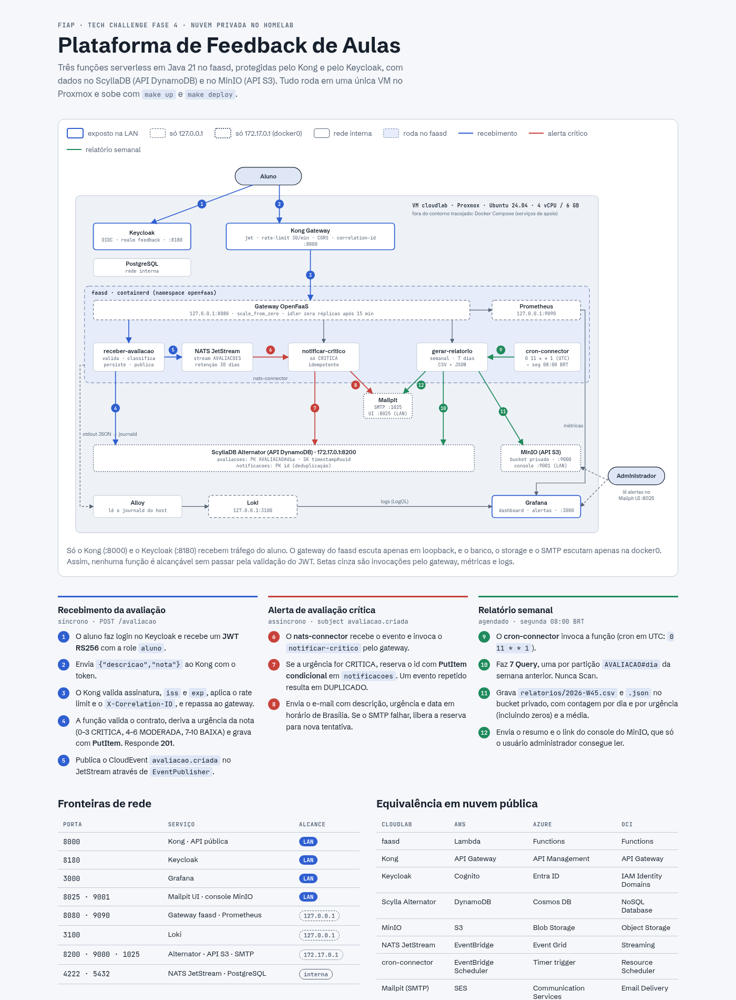
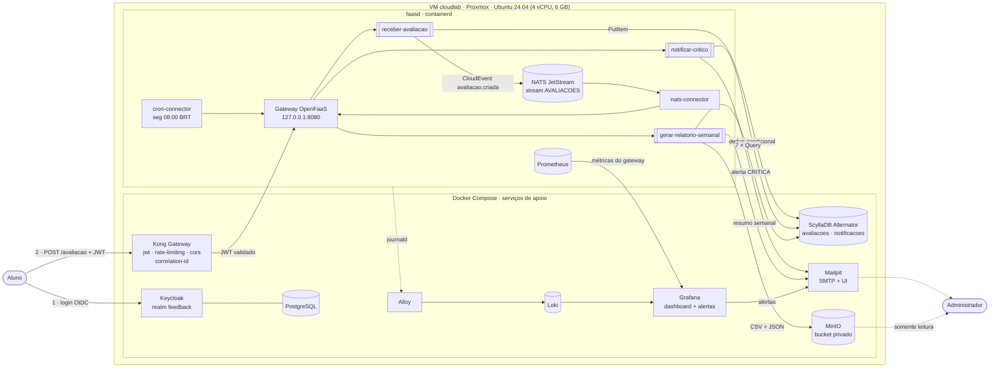

# Plataforma Serverless de Feedback de Aulas

**FIAP · Pós-Tech Arquitetura e Desenvolvimento Java · Tech Challenge Fase 4**

Alunos avaliam aulas (`descricao` + `nota`). A plataforma classifica a urgência, alerta
os administradores na hora quando a avaliação é **CRÍTICA** e envia toda segunda-feira um
**relatório semanal** consolidado. Tudo roda em funções serverless (FaaS) numa **nuvem
privada** montada num homelab Proxmox, com componentes cloud-native equivalentes aos
serviços gerenciados da AWS, Azure e OCI. O professor autorizou esse ambiente.

| | |
|---|---|
| Linguagem | Java 21, Maven multi-módulo, sem Spring (Javalin + of-watchdog HTTP) |
| FaaS | OpenFaaS **faasd** (containerd, sem Kubernetes) com scale-to-zero |
| Entrada | Kong Gateway (DB-less) → JWT do Keycloak |
| Dados | ScyllaDB Alternator (API DynamoDB) · MinIO (API S3) |
| Eventos | NATS JetStream + CloudEvents 1.0 · cron-connector |
| Observabilidade | Prometheus · Loki/Alloy · Grafana (dashboard e alertas como código) |
| Infra como código | Terraform (bpg/proxmox) + cloud-init · docker-compose · stack.yml · Makefile |



> Visão geral navegável: [`docs/img/visao-geral.png`](docs/img/visao-geral.png) · fonte HTML em
> [`docs/arquitetura/`](docs/arquitetura/) · **10 decisões de arquitetura registradas** em [`docs/adr/`](docs/adr/README.md).

---

## Sumário

1. [Arquitetura](#1-arquitetura)
2. [Equivalência com nuvens públicas](#2-equivalência-com-nuvens-públicas)
3. [Modelo de nuvem e portabilidade](#3-modelo-de-nuvem-e-portabilidade)
4. [Contrato da API](#4-contrato-da-api)
5. [Regra de urgência](#5-regra-de-urgência)
6. [Trade-off: DynamoDB Streams × publicação explícita](#6-trade-off-dynamodb-streams--publicação-explícita)
7. [Funções](#7-funções)
8. [Modelagem de dados](#8-modelagem-de-dados)
9. [Segurança, governança e LGPD](#9-segurança-governança-e-lgpd)
10. [Observabilidade](#10-observabilidade)
11. [Exemplos gerados](#11-exemplos-gerados)
12. [Deploy passo a passo](#12-deploy-passo-a-passo)
13. [Testes](#13-testes)
14. [Organização do repositório e trabalho em grupo](#14-organização-do-repositório-e-trabalho-em-grupo)
15. [Roteiro do vídeo de demonstração](#15-roteiro-do-vídeo-de-demonstração)
16. [Decisões, limitações e próximos passos](#16-decisões-limitações-e-próximos-passos)

### Documentação complementar ([docs/](docs/README.md))

| | |
|---|---|
| [Matriz de requisitos](docs/requisitos.md) | cada requisito do enunciado → onde está → como foi verificado |
| [OpenAPI](docs/api/openapi.yaml) · [AsyncAPI](docs/api/asyncapi.yaml) | contratos da API e do evento `avaliacao.criada` |
| [ADRs](docs/adr/README.md) | 10 decisões de arquitetura registradas |
| [Runbook de operação](docs/operacao.md) | saúde, logs, reprocessamento, segredos, backup, troubleshooting |
| [LGPD](docs/lgpd.md) | relatório de impacto simplificado |
| READMEs dos módulos | [commons](commons/README.md) · [receber-avaliacao](receber-avaliacao/README.md) · [notificar-critico](notificar-critico/README.md) · [gerar-relatorio-semanal](gerar-relatorio-semanal/README.md) |

---

## 1. Arquitetura



**Fluxo principal**

1. O aluno se autentica no Keycloak (OIDC) e recebe um JWT RS256 com a role `aluno`.
2. `POST /avaliacao` chega ao **Kong**, que valida assinatura, `iss` e `exp` do JWT, aplica
   rate limiting/CORS e injeta um `X-Correlation-ID`. Nenhuma função é exposta diretamente:
   o gateway do faasd escuta só em `127.0.0.1`.
3. **receber-avaliacao** valida o contrato, deriva a urgência pela nota, grava no Alternator
   e publica o CloudEvent `avaliacao.criada` no JetStream (atrás de `EventPublisher`).
4. O **nats-connector** entrega o evento ao **notificar-critico**, que só age se a urgência
   for `CRITICA`. A deduplicação usa escrita condicional, então o administrador recebe
   **um** e-mail por avaliação.
5. Toda segunda-feira às 08:00 (Brasília), o **cron-connector** dispara o
   **gerar-relatorio-semanal**: 7 `Query` (uma por dia), CSV + JSON no MinIO e um e-mail-resumo.
6. Logs JSON com `correlationId` vão para o Loki, métricas do gateway para o Prometheus, e o
   Grafana mostra o dashboard e envia os alertas.

**Onde cada coisa roda.** O faasd gerencia os próprios serviços (gateway, NATS, Prometheus,
connectors) e as funções no **containerd**. Os serviços de apoio rodam no **Docker Engine**,
que usa o mesmo containerd em outro namespace. As funções, na bridge `openfaas0`, alcançam
Alternator, MinIO e SMTP pelo IP da `docker0` (`HOST_INTERNO=172.17.0.1`), que fica fora da
rede local.

---

## 2. Equivalência com nuvens públicas

| Componente (cloudlab) | Papel | AWS | Azure | OCI | Por que é equivalente |
|---|---|---|---|---|---|
| **OpenFaaS faasd** + of-watchdog | FaaS: execução por evento, escala a zero, cobrança/recurso por uso | AWS Lambda (imagem de container) | Azure Functions (container custom / Flex Consumption) | OCI Functions (baseado no Fn Project) | Mesmo modelo: função empacotada como imagem OCI, invocada via HTTP/evento, sem servidor dedicado por função, escala a zero. O OCI Functions também é baseado em containers. |
| **Kong Gateway** (DB-less) | Porta de entrada: rotas, validação de JWT, throttling, CORS | Amazon API Gateway (JWT authorizer, usage plans) | Azure API Management (`validate-jwt`, `rate-limit`) | OCI API Gateway (JWT auth policy, rate limiting) | Os três validam JWT de um IdP OIDC, limitam taxa e aplicam CORS de forma declarativa, como o `kong.yaml`. |
| **Keycloak** (+ PostgreSQL) | Identidade OIDC, roles `aluno`/`admin` | Amazon Cognito (User Pools + groups) | Microsoft Entra ID / External ID (app roles) | OCI IAM Identity Domains | Emissores OIDC padrão: JWT assinado, JWKS público, claims de grupo/role. Trocar de IdP é trocar o issuer no gateway. |
| **ScyllaDB Alternator** | Banco chave-valor serverless (PK/SK, Query, escrita condicional) | **Amazon DynamoDB** (mesma API) | Azure Cosmos DB for NoSQL | OCI NoSQL Database | O Alternator implementa o protocolo do DynamoDB. O mesmo código (AWS SDK v2) roda contra o DynamoDB só removendo o `endpointOverride`. Cosmos e OCI NoSQL oferecem o mesmo modelo de partição + ordenação. |
| **MinIO** | Object storage privado para relatórios | **Amazon S3** (mesma API) | Azure Blob Storage | OCI Object Storage (API de compatibilidade S3) | API S3 nativa: bucket privado, políticas IAM no formato da AWS, usuário de serviço com privilégio mínimo. |
| **NATS JetStream** + CloudEvents | Barramento de eventos de domínio com retenção | Amazon EventBridge / SNS+SQS (ou DynamoDB Streams, ver §6) | Azure Event Grid (CloudEvents nativo) / Service Bus | OCI Streaming / OCI Events | Pub/sub durável com subjects e replay. CloudEvents é o formato padrão da CNCF, aceito nativamente pelo Event Grid e pelo EventBridge. |
| **nats-connector** | Gatilho “evento → função” | Event source mapping / regra do EventBridge → Lambda | Trigger do Event Grid/Service Bus → Function | OCI Events / Connector Hub → Functions | Assina o tópico e invoca a função com o evento no corpo, como os triggers gerenciados. |
| **cron-connector** | Agendamento (seg 08:00 BRT) | Amazon EventBridge Scheduler | Timer trigger do Azure Functions | OCI Resource Scheduler¹ | Expressão cron que dispara a função, sem servidor dedicado. |
| **Mailpit** (SMTP) | Envio de e-mail (alertas e relatório) | Amazon SES (SMTP) | Azure Communication Services Email | OCI Email Delivery (SMTP) | A função fala SMTP padrão; em produção basta apontar `SMTP_HOST` para o relay gerenciado. O Mailpit captura as mensagens e mostra numa UI, o que facilita a demonstração. |
| **Prometheus** (do faasd) | Métricas de invocação, erro e latência | Amazon CloudWatch Metrics / Amazon Managed Service for Prometheus | Azure Monitor (Managed Prometheus) | OCI Monitoring | Métricas por função coletadas pela plataforma, consultáveis e alertáveis. |
| **Loki + Alloy** | Logs centralizados e estruturados | Amazon CloudWatch Logs (Logs Insights) | Azure Monitor Logs (Log Analytics) | OCI Logging (+ Logging Analytics) | Coleta automática do stdout das funções, consulta por campos JSON (`correlationId`, `evento`). |
| **Grafana** | Dashboards e alertas como código | Amazon Managed Grafana / CloudWatch Dashboards + Alarms | Azure Managed Grafana / Azure Monitor Alerts | OCI Monitoring (dashboards + alarms) | O mesmo JSON de dashboard e as mesmas regras YAML podem ser provisionados nos Grafanas gerenciados de AWS e Azure. |
| **Terraform + Proxmox + cloud-init** | Provisionamento da infraestrutura | Terraform + EC2/AMI (ou só os serviços gerenciados) | Terraform + VM | Terraform + Compute | Infra declarada e reproduzível. Na nuvem pública, a VM some e o Terraform passa a declarar os serviços gerenciados. |

¹ O OCI não tem um cron nativo para Functions tão direto quanto o EventBridge Scheduler.
Confirme o suporte do Resource Scheduler na sua região; a alternativa é um `CronJob` no OKE
invocando a função.

---

## 3. Modelo de nuvem e portabilidade

**Por que nuvem privada sobre Proxmox.** O objetivo pedagógico é entender o que um serviço
gerenciado faz por baixo. Num homelab, o grupo opera cada peça (IdP, gateway, FaaS,
banco, filas, observabilidade) e entende o que cada uma faz, sem custo de nuvem e sem risco
de conta. O professor autorizou. Mesmo assim, o ambiente tem as propriedades
de nuvem que o desafio cobra:

- **Self-service e reprodutível**: `terraform apply` cria a VM; `make up` sobe tudo. Nada é
  configurado à mão.
- **Elasticidade por função**: o faasd escala cada função de forma independente, e o idler
  ([infra/faasd/idler.sh](infra/faasd/idler.sh)) faz scale-to-zero após 15 min ociosa.
- **Serviços sob demanda por API**: banco (API DynamoDB), storage (API S3), eventos,
  identidade (OIDC) e e-mail (SMTP) são consumidos por protocolo, não por biblioteca
  proprietária.
- **Medição**: invocações, erros e latência por função no Prometheus/Grafana.

**Garantias de portabilidade para nuvem pública**

| Camada | Como a portabilidade é garantida |
|---|---|
| Código | AWS SDK v2 com `endpointOverride` configurável (`ALTERNATOR_ENDPOINT`, `S3_ENDPOINT`). Na AWS, remove-se a variável e o SDK usa DynamoDB/S3 reais com IAM role. |
| Empacotamento | Imagem OCI padrão (`Dockerfile` único). Roda em Lambda (container image), Azure Functions custom container, OCI Functions, Cloud Run ou Kubernetes. |
| Eventos | Domínio depende só de `EventPublisher`; o formato é CloudEvents 1.0. Trocar NATS por EventBridge/Event Grid é uma nova implementação da interface. |
| Identidade | OIDC/JWT padrão; o gateway valida `iss` + chave pública. Trocar Keycloak por Cognito/Entra é configuração. |
| Configuração | 100% por variáveis de ambiente + secrets (12-factor). Nada hardcoded. |
| Infra | Terraform. O provider muda (proxmox → aws/azurerm/oci), o modelo declarativo continua. |

**Lock-in consciente**: a chave composta PK/SK e o uso de `Query` seguem o modelo DynamoDB.
Isso é portável para Cosmos DB e OCI NoSQL, mas exige adaptar o repositório (uma classe:
`AvaliacaoRepository`).

---

## 4. Contrato da API

```http
POST /avaliacao
Authorization: Bearer <JWT do Keycloak, role aluno>
Content-Type: application/json

{ "descricao": "O professor não compareceu.", "nota": 2 }
```

> **Rota sem acento.** O enunciado grafa `/avaliação`. Usamos **`/avaliacao`** porque
> caracteres não-ASCII em path exigem percent-encoding (`/avalia%C3%A7%C3%A3o`), e clientes,
> proxies e logs tratam isso de formas diferentes. A rota ASCII evita esse problema.

| Campo | Regra |
|---|---|
| `descricao` | string obrigatória, não vazia (após `trim`), até `DESCRICAO_MAX` (padrão 1000) caracteres |
| `nota` | inteiro obrigatório de 0 a 10 (`"7"`, `7.5` e `null` são rejeitados) |
| outros campos | **rejeitados** (o contrato é seguido à risca; `alunoId` vem sempre do JWT, nunca do body) |

**Respostas**

| Status | Quando | Corpo |
|---|---|---|
| `201` | gravada | `{"id":"…","urgencia":"CRITICA","dataEnvio":"2026-11-05T22:09:27.965Z"}` |
| `400` | payload inválido | `{"erro":"PAYLOAD_INVALIDO","mensagem":"Avaliação inválida.","detalhes":["nota: deve estar entre 0 e 10"],"correlationId":"…"}` |
| `401` | sem JWT / JWT inválido ou expirado | Kong: `{"message":"Unauthorized"}` |
| `403` | JWT válido sem a role `aluno` | `{"erro":"SEM_PERMISSAO",…}` |
| `429` | mais de 30 req/min (ou 500/h) por IP | Kong: `{"message":"Limite de requisições excedido…"}` |

Toda resposta traz `X-Correlation-ID`, o mesmo valor que aparece nos logs e no evento.

---

## 5. Regra de urgência

A urgência **não vem na entrada**: é **derivada da nota** por `ClassificadorUrgencia`
(módulo `commons`), que é a única fonte da regra.

| Nota | Urgência | Efeito |
|---|---|---|
| 0 a 3 | `CRITICA` | alerta imediato por e-mail ao administrador |
| 4 a 6 | `MODERADA` | entra no relatório semanal |
| 7 a 10 | `BAIXA` | entra no relatório semanal |

Os limites são variáveis de ambiente da função `receber-avaliacao`: `LIMITE_CRITICA=3`,
`LIMITE_MODERADA=6`. O construtor rejeita configurações incoerentes
(`0 ≤ LIMITE_CRITICA < LIMITE_MODERADA < 10`).

**Por que derivada da nota?**

- **Contrato mínimo**: o enunciado define só `descricao` e `nota`.
- **Consistência**: se a urgência viesse do aluno, uma nota 1 poderia chegar marcada como
  "BAIXA". Derivar da nota garante que a mesma nota sempre tenha a mesma urgência.
- **Segurança**: o cliente não controla quem recebe alerta, o que evita spam de alertas e
  avaliações críticas escondidas.

**Por que persistida (e não recalculada na leitura)?**

- **Imutabilidade histórica**: se a coordenação mudar `LIMITE_CRITICA` para 4, as avaliações
  antigas continuam com a classificação que tinham ao chegar. Relatórios passados não mudam
  e o alerta enviado continua coerente com o registro.
- **Desacoplamento**: `notificar-critico` e `gerar-relatorio-semanal` leem a urgência pronta
  e não precisam conhecer a regra nem os limites.
- **Auditoria**: o evento `avaliacao.criada` carrega a urgência decidida no recebimento.

---

## 6. Trade-off: DynamoDB Streams × publicação explícita

Na AWS, o desenho idiomático seria **DynamoDB Streams → Lambda**: a gravação na tabela gera
o evento sozinha, de forma atômica, e o `notificar-critico` consome o stream.

No ScyllaDB Alternator, Streams é um recurso **experimental** (baseado em CDC), e o faasd não
tem um gatilho equivalente ao *event source mapping* da Lambda. Por isso, a
`receber-avaliacao` **publica explicitamente** o CloudEvent após gravar, através da
interface `EventPublisher`:

```java
public interface EventPublisher { void publicar(CloudEvent evento); }   // domínio
public class NatsEventPublisher implements EventPublisher { … }          // infraestrutura
```

| | DynamoDB Streams (AWS) | Publicação explícita (este projeto) |
|---|---|---|
| Atomicidade gravação + evento | garantida pelo banco | **não** é atômica (*dual write*) |
| Acoplamento do domínio | nenhum (o banco emite) | domínio conhece só `EventPublisher` |
| Formato do evento | registro do stream (específico da AWS) | CloudEvents 1.0 (padrão CNCF) |
| Portabilidade | só AWS | qualquer broker (NATS, EventBridge, Event Grid, Kafka) |
| Filtro | na Lambda | no consumidor (`urgencia == CRITICA`) |

**Mitigações do dual write:**

1. A gravação vem **antes** da publicação. Se o NATS falhar, a avaliação não se perde,
   aparece no relatório semanal, e o erro é logado como `evento_nao_publicado` (nível
   ERROR), o que dispara o alerta **"Logs de erro nas funções"** no Grafana.
2. `jetStream.publish` aguarda o **ack de persistência**, e `Nats-Msg-Id` = id do evento
   habilita a deduplicação do JetStream.
3. O consumidor é **idempotente** (deduplicação condicional pelo id da avaliação).

Se a garantia "todo CRITICA gera alerta" virar requisito forte, o próximo passo é o padrão
**transactional outbox**, e a interface `EventPublisher` não muda. Ao migrar para AWS, basta
uma implementação nula de `EventPublisher` + DynamoDB Streams, ou uma `EventBridgePublisher`.

---

## 7. Funções

Detalhes de cada módulo (classes, como rodar localmente) estão no README do módulo. O
contrato HTTP está em [docs/api/openapi.yaml](docs/api/openapi.yaml) e o do evento em
[docs/api/asyncapi.yaml](docs/api/asyncapi.yaml).

Todas as funções são imagens com **of-watchdog (modo HTTP)** + **Javalin** em `127.0.0.1:8082`.
O processo fica aquecido entre invocações, há health check em `/health`, e os logs saem em
JSON puro (`prefix_logs=false`). Variáveis comuns: `ALTERNATOR_ENDPOINT`, `AWS_REGION`,
`FUSO_NEGOCIO=America/Sao_Paulo`.

### 7.1 `receber-avaliacao`

| | |
|---|---|
| **Gatilho** | HTTP `POST /avaliacao` (Kong → gateway faasd) |
| **Entrada** | `{"descricao": string, "nota": int}` + `Authorization: Bearer <JWT>` + `X-Correlation-ID` |
| **Saída** | `201 {id, urgencia, dataEnvio}` · `400`/`401`/`403` padronizados · evento `avaliacao.criada` no subject NATS de mesmo nome (stream `AVALIACOES`, retenção 30 dias) |
| **Env vars** | `TABELA_AVALIACOES=avaliacoes`, `LIMITE_CRITICA=3`, `LIMITE_MODERADA=6`, `DESCRICAO_MAX=1000`, `NATS_URL=nats://nats-js:4222` |
| **Secrets** | `alternator-access-key`, `alternator-secret-key` |
| **Permissões** | `PutItem`/`CreateTable` em `avaliacoes`; publicar em `avaliacao.>`. Exige a role `aluno` no JWT. |
| **Limites** | 256 MiB, scale-to-zero |

### 7.2 `notificar-critico`

| | |
|---|---|
| **Gatilho** | NATS subject `avaliacao.criada` via **nats-connector** (anotação `topic: avaliacao.criada`) |
| **Entrada** | CloudEvent JSON (`type=avaliacao.criada`, `data` = avaliação **sem** `alunoId`, extensão `correlationid`) |
| **Saída** | e-mail aos administradores com **descrição, urgência e data de envio em horário de Brasília**; resposta `{"resultado":"NOTIFICADO" \| "IGNORADO" \| "DUPLICADO"}` |
| **Regras** | processa só `urgencia == CRITICA`; idempotente: `PutItem` condicional (`attribute_not_exists(id)`) em `notificacoes`. Se o SMTP falhar, a reserva é desfeita para permitir nova tentativa. |
| **Env vars** | `TABELA_NOTIFICACOES=notificacoes`, `SMTP_HOST`, `SMTP_PORT=1025`, `EMAIL_REMETENTE`, `EMAIL_ADMINS` (lista separada por vírgula) |
| **Secrets** | `alternator-access-key`, `alternator-secret-key` |
| **Permissões** | `PutItem`/`DeleteItem`/`CreateTable` em `notificacoes`; envio SMTP |

### 7.3 `gerar-relatorio-semanal`

| | |
|---|---|
| **Gatilho** | **cron-connector**, `schedule: "0 11 * * 1"` = segunda-feira 08:00 em Brasília (o connector usa UTC; o Brasil não tem horário de verão desde 2019) |
| **Entrada** | nenhuma. Opcional para demonstração: `?data=AAAA-MM-DD` como data de referência. |
| **Processo** | período = 7 dias anteriores à referência; **7 `Query`** (`PK = AVALIACAO#<dia>`), **nunca Scan** |
| **Saída** | `relatorios/<ano>-W<semana>.json` e `.csv` no bucket privado; e-mail com contagens, média e link do console MinIO |
| **Conteúdo** | lista (descrição, urgência, data de envio), quantidade por dia (com zeros), por urgência (com zeros), média geral (2 casas; `null` / "sem avaliações" em semana vazia) |
| **Env vars** | `TABELA_AVALIACOES`, `S3_ENDPOINT`, `BUCKET_RELATORIOS`, `MINIO_CONSOLE_URL`, `SMTP_HOST`, `SMTP_PORT`, `EMAIL_REMETENTE`, `EMAIL_ADMINS` |
| **Secrets** | `alternator-*`, `minio-access-key`, `minio-secret-key` (usuário `svc-relatorio`) |
| **Permissões** | `Query` em `avaliacoes`; **somente `s3:PutObject` em `relatorios/*`**. Não lê nem lista o bucket. |
| **Limites** | 320 MiB, scale-to-zero |

Semana sem avaliações gera relatório **válido e vazio** (zeros em todos os dias e níveis),
grava os arquivos e envia o e-mail normalmente
([exemplo](docs/exemplos/email-relatorio-semana-vazia.txt)).

---

## 8. Modelagem de dados

**Tabela `avaliacoes`** (Alternator / DynamoDB)

| Atributo | Tipo | Exemplo |
|---|---|---|
| `PK` (partição) | S | `AVALIACAO#2026-11-05` |
| `SK` (ordenação) | S | `2026-11-05T22:09:27.965Z#fd8bd9b2-…` |
| `id` | S | `fd8bd9b2-3eeb-4bc6-993f-7f7948613149` |
| `alunoId` | S | `183c3919-…` (claim `sub` do Keycloak) |
| `descricao` | S | `O professor não compareceu.` |
| `nota` | N | `2` |
| `urgencia` | S | `CRITICA` |
| `dataEnvio` | S | `2026-11-05T22:09:27.965Z` (UTC, ISO-8601) |

- **Uma partição por dia**: o relatório semanal faz exatamente 7 `Query` baratas e previsíveis.
- O dia da PK usa o **fuso de Brasília**. Uma avaliação enviada às 23:30 de domingo (02:30 UTC de
  segunda) pertence a domingo, que é o dia que a coordenação enxerga. O teste de integração
  cobre esse caso.
- A SK começa pelo timestamp ISO, então a `Query` já devolve as avaliações em ordem
  cronológica; o UUID evita colisão.
- *Hot partition*: todas as escritas do dia caem numa partição. Para o volume de uma turma
  isso é irrelevante. Em escala, use *write sharding* (`AVALIACAO#<dia>#<0..N>`) e N×7 queries.

**Tabela `notificacoes`**: `id` (PK) + `processadoEm`. Serve como registro de deduplicação
do alerta.

---

## 9. Segurança, governança e LGPD

### Controles implementados

| Controle | Onde |
|---|---|
| JWT RS256 validado **antes** de chegar à função (assinatura, `iss`, `exp`) | Kong `jwt` ([infra/kong.yaml](infra/kong.yaml)) |
| Nenhuma função exposta: gateway faasd em `127.0.0.1:8080`; Kong usa a rede do host | [infra/faasd/docker-compose.yaml](infra/faasd/docker-compose.yaml) |
| Autorização por role: `aluno` envia avaliação (`403` caso contrário) | `ReceberAvaliacao` |
| `alunoId` sempre da claim `sub`; body com campo extra é rejeitado | `ReceberAvaliacao` |
| Rate limiting (30/min, 500/h por IP), CORS restrito a `CORS_ORIGIN`, limite de payload de 16 KB | Kong |
| Token só no header `Authorization` (desabilitado em query string/cookie) | Kong `jwt` |
| Chave RSA do realm gerada localmente (`scripts/preparar.sh`), nunca versionada | `.gitignore` → `infra/.gerado/` |
| Segredos via `.env` (gerado com valores aleatórios; só `.env.example` é versionado) e **secrets do OpenFaaS** montados em `/var/openfaas/secrets` | `make segredos`, `Config.segredo()` |
| MinIO: bucket **privado** (sem acesso anônimo); `svc-relatorio` só `PutObject` em `relatorios/*`; `admin-relatorios` só leitura | [infra/minio/init.sh](infra/minio/init.sh) |
| Alternator, API do MinIO e SMTP escutam só no IP da `docker0`: inacessíveis pela LAN | `HOST_INTERNO` no compose |
| Keycloak com proteção contra força bruta e access token de 5 min | realm |

**Somente admin acessa relatórios**: os administradores entram no console do MinIO
(`:9001`) com o usuário `admin-relatorios` (política `relatorio-leitura`). A função não tem
permissão de leitura e alunos não têm credencial. Como evolução, o login do console pode
ser federado ao Keycloak (OpenID no MinIO, com a claim de política derivada da role `admin`).

> **Homelab × produção**: o tráfego aqui é HTTP na rede local (`sslRequired: none` no realm).
> Em produção: TLS no Kong (certificado ACME), `sslRequired: external`, Keycloak atrás de HTTPS.

### Tratamento dos dados do aluno (LGPD, Lei 13.709/2018)

Resumo abaixo; o relatório completo (inventário, fluxo, base legal, retenção, riscos e
incidentes) está em [docs/lgpd.md](docs/lgpd.md).

| Princípio / artigo | Como o projeto atende |
|---|---|
| **Finalidade e adequação** (art. 6º, I e II) | Os dados servem só para melhorar a qualidade das aulas: alerta de problemas graves e consolidação semanal. |
| **Necessidade / minimização** (art. 6º, III) | O domínio guarda só o `sub` do Keycloak (UUID pseudônimo), sem nome, e-mail ou matrícula. O **evento** e o **relatório** **não** carregam `alunoId`. Os logs não registram `descricao` nem `alunoId`, só id, nota e urgência. |
| **Pseudonimização** (art. 13, §4º) | A reidentificação depende do Keycloak, que é um sistema separado e com acesso restrito. |
| **Segurança** (art. 46) | Controles da tabela acima: autenticação forte, privilégio mínimo, segredos fora do código, segmentação de rede, rastreabilidade por `correlationId`. |
| **Transparência** (art. 6º, VI) | Recomendação: o front-end deve informar que a descrição é lida pela coordenação e pedir para não incluir dados pessoais de terceiros no texto livre. |
| **Retenção** (art. 15 e 16) | Eventos no JetStream expiram em 30 dias. Para as avaliações, recomenda-se definir prazo (ex.: semestre letivo + 1 ano) e expurgar por partição diária, o que o modelo `AVALIACAO#<dia>` facilita (TTL do Alternator ou job de expurgo). |
| **Direitos do titular** (art. 18) | Acesso/eliminação localizam as avaliações pelo `alunoId` (`sub`). Hoje isso exige varredura administrativa; para atender com eficiência, adicionar um GSI por `alunoId`. |
| **Papéis** | A instituição (FIAP) é a **controladora**. A plataforma atua como **operadora**. A base legal sugerida (execução de contrato educacional / legítimo interesse, art. 7º, V e IX) deve ser validada pelo encarregado (DPO). |

---

## 10. Observabilidade

| Sinal | Origem | Destino |
|---|---|---|
| Logs JSON das funções (`ts`, `nivel`, `evento`, `correlationId`, …) | stdout → journald (`SYSLOG_IDENTIFIER=openfaas-fn:<função>`) | **Alloy** → **Loki** (labels `funcao`, `nivel`, `job=faasd`) |
| Métricas de invocação, código HTTP, duração, réplicas | gateway OpenFaaS | **Prometheus** do faasd → Grafana |
| Avaliações por urgência | log `avaliacao_registrada` | LogQL no Loki |

O **correlationId** nasce no Kong (`correlation-id`), é lido por `Servidor` (commons) e
gravado em todo log via `Log`. Ele viaja no CloudEvent (extensão `correlationid`) até o
`notificar-critico`. Basta colar o valor no filtro do dashboard para ver a requisição e o
alerta que ela gerou.

### Dashboard (provisionado: [infra/grafana/dashboards/feedback-funcoes.json](infra/grafana/dashboards/feedback-funcoes.json))

Pasta **Feedback de Aulas → "Feedback de Aulas - Funções"** em `http://cloudlab:3000`:

- **Avaliações por urgência** (stat no período + barras empilhadas no tempo; CRITICA em vermelho)
- **Réplicas ativas**: mostra o scale-to-zero acontecendo
- **Invocações por função** (req/s) · **Taxa de erro por função** (% 5xx) · **Duração p95**
- **Logs das funções** com filtro por função e por `correlationId`

### Alertas (provisionados: [infra/grafana/provisioning/alerting/alertas.yaml](infra/grafana/provisioning/alerting/alertas.yaml))

| Alerta | Condição | Severidade |
|---|---|---|
| Taxa de erro das funções > 0 | `sum(rate(gateway_function_invocation_total{code=~"5.."}[5m])) > 0` | alta |
| Logs de erro nas funções | `count_over_time({job="faasd", nivel="ERROR"}[5m]) > 0` (cobre `evento_nao_publicado`) | alta |
| Pico de avaliações CRÍTICA | mais de 5 `avaliacao_registrada` com `urgencia=CRITICA` em 15 min | média |

Notificação por e-mail para `EMAIL_ADMINS` (contact point `administradores`, via Mailpit).

### Prints

> Os prints do dashboard e do alerta são capturados na cloudlab após rodar a collection do Postman (ver §15) e ainda não estão versionados.

---

## 11. Exemplos gerados

Os arquivos abaixo foram **gerados pelas funções reais** durante a validação (não foram
escritos à mão):

- E-mail de alerta: [docs/exemplos/email-alerta-critico.txt](docs/exemplos/email-alerta-critico.txt)
- E-mail do relatório: [docs/exemplos/email-relatorio-semanal.txt](docs/exemplos/email-relatorio-semanal.txt) · semana vazia: [email-relatorio-semana-vazia.txt](docs/exemplos/email-relatorio-semana-vazia.txt)
- Relatório: [CSV](docs/exemplos/relatorio-2026-W44.csv) · [JSON](docs/exemplos/relatorio-2026-W44.json)

**Alerta de avaliação crítica**

```text
Assunto: [ALERTA] Avaliação CRÍTICA recebida - nota 2
De: feedback@cloudlab.local
Para: coordenacao@fiap.local

Uma avaliação de aula foi classificada como CRÍTICA e requer atenção.

Descrição:      Aula nota 2
Urgência:       CRITICA
Data de envio:  05/11/2026 19:09:27 (horário de Brasília)
Nota:           2
ID:             fd8bd9b2-3eeb-4bc6-993f-7f7948613149
```

**Relatório semanal (e-mail)**

```text
Assunto: Relatório semanal de avaliações - 2026-W44

Relatório semanal de avaliações - semana 2026-W44 (2026-10-30 a 2026-11-05)

Total de avaliações: 3
Média geral das notas: 5.33

Quantidade por urgência:
  CRITICA   1
  MODERADA  1
  BAIXA     1

Quantidade por dia:
  2026-10-30 0
  …
  2026-11-05 3

Relatório completo (login de administrador no MinIO):
  http://cloudlab:9001/browser/feedback-relatorios
  objetos: relatorios/2026-W44.csv e relatorios/2026-W44.json
```

> Esse exemplo foi gerado com `?data=2026-11-06` (período de 30/10 a 05/11). No cron de
> segunda-feira, o período vai sempre de segunda a domingo da semana ISO anterior.

---

## 12. Deploy passo a passo

### 12.0 Pré-requisitos

- Proxmox VE 8.x com um datastore que aceite o conteúdo **snippets** (ex.: `local`:
  *Datacenter → Storage → local → Content → Snippets*).
- Token de API do Proxmox para o Terraform (*Datacenter → Permissions → API Tokens*) e
  acesso SSH ao nó (o provider envia o snippet de cloud-init por SSH; use `ssh-agent`).
- Na máquina do integrante: Terraform ≥ 1.6, chave SSH, e uma conta num registry de
  imagens (ex.: GHCR).
- **Template Ubuntu 24.04 cloud-init** (uma vez, no nó Proxmox):

```bash
wget https://cloud-images.ubuntu.com/noble/current/noble-server-cloudimg-amd64.img
qm create 9000 --name ubuntu-2404-cloudinit --memory 2048 --net0 virtio,bridge=vmbr0 \
  --scsihw virtio-scsi-pci --agent enabled=1 --serial0 socket --vga serial0
qm set 9000 --scsi0 local-lvm:0,import-from=$PWD/noble-server-cloudimg-amd64.img
qm set 9000 --ide2 local-lvm:cloudinit --boot order=scsi0
qm template 9000
```

### 12.1 Provisionar a VM `cloudlab` (Terraform)

```bash
cd infra/terraform
cp terraform.tfvars.example terraform.tfvars        # ajuste endpoint, nó, IP, chave SSH, repo_url
export TF_VAR_proxmox_api_token='terraform@pve!tf=xxxxxxxx-xxxx'
terraform init
terraform apply                                     # ou, na raiz: make provisionar
```

O cloud-init ([cloud-init.yaml.tftpl](infra/terraform/cloud-init.yaml.tftpl)) cria o usuário,
instala JDK 21, Docker Engine, faasd 0.19.7, CNI e faas-cli
([scripts/instalar-cloudlab.sh](scripts/instalar-cloudlab.sh)) e clona o repositório em
`/opt/feedback`. Para acompanhar:

```bash
ssh fiap@<ip> cloud-init status --wait
```

Na máquina de quem vai acessar (navegador/Postman), resolva o nome:
`echo "<ip> cloudlab" | sudo tee -a /etc/hosts`.

### 12.2 Subir a plataforma (`make up`)

```bash
ssh fiap@cloudlab
cd /opt/feedback
make up
```

`make up` faz, de forma idempotente:

1. `scripts/preparar.sh`: cria `.env` a partir de `.env.example` com **senhas aleatórias**,
   gera a chave RSA do realm e renderiza `infra/.gerado/kong.yaml`;
2. `docker compose up -d --wait`: Postgres, Keycloak (importa o realm), Kong, ScyllaDB,
   MinIO, Mailpit, Loki, Alloy e Grafana, esperando **todos os healthchecks**;
3. `minio-init`: bucket privado, políticas e usuários;
4. overlay do faasd: NATS JetStream, nats-connector, cron-connector, gateway só em loopback
   e o timer de scale-to-zero.

Verificação: `docker compose --env-file .env -f infra/docker-compose.yaml ps` (todos `healthy`)
e `sudo journalctl -u faasd -n 20`.

### 12.3 Publicar as funções (`make deploy`)

```bash
vi .env                       # REGISTRY=ghcr.io/<org>  TAG=0.1.0
docker login ghcr.io          # token com write:packages
make deploy
```

`make deploy` roda `./mvnw verify` (unitários + integração), constrói e publica as três
imagens, copia as credenciais do registry para o faasd, cria os **secrets** do OpenFaaS e
aplica o `stack.yml`.

```bash
faas-cli list -g http://127.0.0.1:8080        # 3 funções
make logs F=receber-avaliacao                 # logs de uma função
make logs S=kong                              # logs de um serviço de apoio
```

### 12.4 Testar

1. Importe [postman/feedback-aulas.postman_collection.json](postman/feedback-aulas.postman_collection.json),
   preencha `senha_aluno`/`senha_admin` com `KC_SENHA_ALUNO_DEMO`/`KC_SENHA_ADMIN_DEMO` do `.env`
   e rode a collection inteira no Runner, **na ordem**.
2. Mailpit: `http://cloudlab:8025` (alertas CRÍTICA).
3. Relatório sob demanda (na VM):
   `curl -X POST "http://127.0.0.1:8080/function/gerar-relatorio-semanal?data=$(date -d tomorrow +%F)"`
4. MinIO: `http://cloudlab:9001`, usuário `admin-relatorios` (senha no `.env`).
5. Grafana: `http://cloudlab:3000` (admin / `GF_ADMIN_PASSWORD`).
6. Keycloak: `http://cloudlab:8180` (admin / `KC_BOOTSTRAP_ADMIN_PASSWORD`).

### 12.5 Desmontar

```bash
make destroy        # remove funções, containers e VOLUMES (dados)
make destroy-vm     # terraform destroy da VM
```

### Portas

| Porta | Serviço | Exposição |
|---|---|---|
| 8000 | Kong (API pública) | LAN |
| 8180 | Keycloak | LAN |
| 3000 | Grafana | LAN |
| 8025 | Mailpit UI | LAN |
| 9001 | Console MinIO | LAN |
| 8080 / 9090 | Gateway faasd / Prometheus | só `127.0.0.1` |
| 3100 | Loki | só `127.0.0.1` |
| 8200 / 9000 / 1025 | Alternator / API S3 / SMTP | só `HOST_INTERNO` (docker0) |

---

## 13. Testes

```bash
./mvnw -q verify     # unitários (surefire) + integração com ScyllaDB real (failsafe/Testcontainers)
make verify          # o mesmo + docker compose config
```

| Classe | O que cobre |
|---|---|
| `ClassificadorUrgenciaTest` | fronteiras 0, 3, 4, 6, 7, 10; inválidos -1, 11, `MIN/MAX_VALUE`; limites configuráveis e incoerentes |
| `AvaliacaoRepositoryIT` | **Testcontainers + ScyllaDB 6.2 Alternator**: criação idempotente de tabela, gravação, `Query` por dia, ordem pela SK, virada de dia em Brasília |
| `ReceberAvaliacaoTest` | caminho feliz (persiste, publica, `alunoId` do JWT, evento sem `alunoId`), 15 payloads inválidos, nota fora do intervalo, 401, 403, falha do NATS sem perder a gravação |
| `NotificarCriticoTest` | dispara **só** para CRITICA; e-mail contém descrição, urgência e data em Brasília; idempotência; libera a reserva se o SMTP falhar |
| `RelatorioTest` | contagem por dia e por urgência com zeros, média (2 casas), semana vazia, CSV com escape |
| `GerarRelatorioSemanalTest` | exatamente **7** consultas (seg a dom anteriores), chaves `relatorios/2026-W45.*`, conteúdo do e-mail, semana vazia sem erro |

Além dos testes automatizados, cada fase foi validada com os serviços reais: compose
saudável, token do Keycloak aceito e token adulterado recusado pelo Kong, jars executando
contra Scylla/NATS/MinIO/Mailpit, políticas do MinIO (admin não grava, serviço não lê),
pipeline journald → Alloy → Loki, alerta do Grafana chegando ao Mailpit e collection
rodada com newman (401/403/429).

---

## 14. Organização do repositório e trabalho em grupo

```text
.
├── commons/                    # regra de urgência, Log/correlationId, clientes AWS SDK, e-mail, Servidor
├── receber-avaliacao/          # função 1 (+ EventPublisher / NatsEventPublisher)
├── notificar-critico/          # função 2 (+ Deduplicador)
├── gerar-relatorio-semanal/    # função 3 (+ Relatorio, ArmazenamentoRelatorios)
├── infra/
│   ├── docker-compose.yaml     # serviços de apoio (healthchecks, volumes nomeados)
│   ├── kong.yaml               # gateway declarativo (template)
│   ├── keycloak/               # realm-feedback.json importado no boot
│   ├── faasd/                  # overlay do faasd (JetStream + connectors) e idler
│   ├── minio/  alloy/  grafana/
│   └── terraform/              # VM cloudlab no Proxmox (bpg/proxmox + cloud-init)
├── scripts/                    # preparar.sh (.env/chaves/kong) · instalar-cloudlab.sh
├── postman/                    # collection
├── docs/                       # requisitos, OpenAPI/AsyncAPI, ADRs, runbook, LGPD
│   └── exemplos/               # e-mails e relatórios reais
├── stack.yml  Dockerfile  Makefile  .env.example
└── CONTRIBUTING.md  .github/   # convenções, template de PR, CODEOWNERS
```

Cada integrante pode ser dono de um diretório (um módulo Maven por função, `commons` e
`infra` separados). Mudanças em `commons` afetam todos e exigem revisão de mais de um dono.
Convenções de branch, commit e PR estão em [CONTRIBUTING.md](CONTRIBUTING.md).

---

## 15. Roteiro do vídeo de demonstração

Sugestão para cerca de 10 minutos, com um integrante por bloco:

| Tempo | Bloco | O que mostrar |
|---|---|---|
| 0:00 | Problema e arquitetura | Diagrama Mermaid; tabela de equivalência AWS/Azure/OCI; por que nuvem privada |
| 1:30 | Infra como código | `terraform apply` (ou o plan) e a VM no Proxmox; `make up` com todos os serviços `healthy`; `faas-cli list` |
| 3:00 | Segurança | Postman: token no Keycloak → `401` sem token → `403` com admin → JWT decodificado (role `aluno`) |
| 4:00 | Regra de urgência | Notas 2, 5 e 9 → CRITICA/MODERADA/BAIXA; explicar por que é derivada e persistida; `400` (nota 11, campo `alunoId`) |
| 5:30 | Alerta crítico | Mailpit com o e-mail (descrição, urgência, data em Brasília); reenviar o mesmo evento e mostrar `DUPLICADO` nos logs |
| 6:30 | Relatório semanal | Anotação `schedule` no `stack.yml`; invocar com `?data=`; CSV/JSON no console MinIO logado como admin; e-mail-resumo |
| 8:00 | Observabilidade | Dashboard (urgência, invocações, p95, réplicas indo a 0); filtrar logs por `correlationId`; alerta de pico de CRÍTICA |
| 9:00 | Rate limit e testes | `429` no Postman; `./mvnw verify` com o Testcontainers subindo o ScyllaDB |
| 9:30 | Fechamento | Trade-off Streams × `EventPublisher`, LGPD, próximos passos |

---

## 16. Decisões, limitações e próximos passos

- **NATS**: o faasd CE 0.19.7 ainda embarca **NATS Streaming** (descontinuado), usado
  internamente pela fila assíncrona do queue-worker. Para os eventos de domínio, o overlay
  adiciona um `nats-js` com **JetStream** no próprio compose do faasd, sem alterar a fila
  interna.
- **Scale-to-zero**: no OpenFaaS CE não existe o `faas-idler` (recurso Pro). O
  `scale_from_zero` do gateway acorda a função, e o `faasd-idler` (systemd timer, ~30 linhas
  de shell) zera as réplicas de funções com `com.openfaas.scale.zero=true` após 15 min sem
  invocações (via métricas do Prometheus).
- **MinIO**: as imagens oficiais `minio/minio` deixaram de ser publicadas em 2025. Usamos o
  build comunitário da Chainguard (mesmo binário AGPL), fixado por digest.
- **Publicação dupla (dual write)**: ver §6; outbox é o próximo passo se o requisito endurecer.
- **Nome do relatório com `?data=`**: a chave usa a semana ISO do primeiro dia do período;
  uma execução manual pode sobrescrever o relatório daquela semana (útil na demo, irrelevante
  para o cron).
- **Próximos passos**: TLS no Kong; GSI por `alunoId` (direitos do titular); TTL/expurgo das
  avaliações; login do console do MinIO federado ao Keycloak; pipeline de CI rodando
  `make verify` em cada PR.
