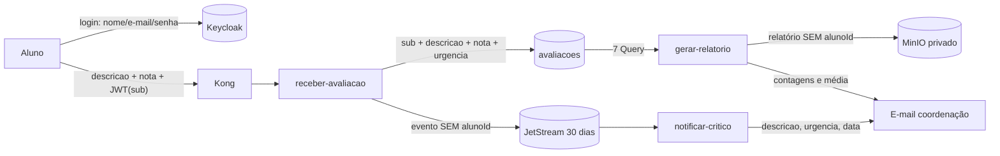

# Proteção de dados pessoais (LGPD)

Relatório de impacto simplificado do tratamento dos dados dos alunos na plataforma de
feedback, à luz da Lei 13.709/2018. É um documento acadêmico. Num cenário real, o
encarregado (DPO) da instituição deve validá-lo.

## 1. Papéis

| Papel | Quem |
|---|---|
| Titular | aluno que envia a avaliação |
| Controladora | instituição de ensino (FIAP), que define as finalidades |
| Operadora | a plataforma (este sistema) e quem a opera |
| Destinatários internos | coordenação/administradores (e-mail de alerta, relatório, console do MinIO) |

## 2. Inventário de dados

| Dado | Origem | Onde é armazenado | Pessoal? | Quem acessa | Retenção |
|---|---|---|---|---|---|
| `sub` do Keycloak (`alunoId`) | claim do JWT | tabela `avaliacoes` | **sim, pseudonimizado** (UUID sem significado fora do Keycloak) | só operadores com acesso ao banco | definir (sugestão abaixo) |
| Nome, e-mail, senha do aluno | cadastro | **somente** Keycloak/PostgreSQL | sim | administradores do IdP | ciclo de vida da conta |
| `descricao` | texto livre do aluno | `avaliacoes`, evento NATS, relatório, e-mail de alerta | **pode conter** (dado inserido pelo próprio aluno, ex.: nome do professor) | coordenação | igual à avaliação |
| `nota`, `urgencia`, `dataEnvio`, `id` | entrada / derivados | `avaliacoes`, evento, relatório | não, isoladamente | coordenação | igual à avaliação |
| IP de origem | conexão | log de acesso do Kong (stdout do container, rotação de 3 × 10 MB) | sim | operadores | rotação automática |
| `correlationId` | gerado pelo Kong | logs (Loki) | não | operadores | política padrão do Loki |

O sistema **não** trata dados sensíveis (art. 5º, II) por desenho. Mesmo assim, o texto livre
pode conter esse tipo de dado por iniciativa do titular (ver riscos).

## 3. Fluxo dos dados

A identidade (quem é o aluno) e a opinião (o que ele escreveu) ficam em sistemas
**separados**. A ligação entre as duas só é possível com acesso privilegiado aos dois.

## 4. Princípios (art. 6º) e medidas

| Princípio | Medida adotada |
|---|---|
| **Finalidade** (I) | uso exclusivo para qualidade das aulas: alerta de problemas graves e consolidação semanal |
| **Adequação** (II) | só o necessário para alertar e consolidar; sem perfilamento do aluno |
| **Necessidade** (III) | o contrato aceita só `descricao` e `nota`; campos extras são rejeitados. O evento, o relatório e os e-mails **não** contêm `alunoId`. Os logs **não** registram `descricao` nem `alunoId`. |
| **Livre acesso** (IV) | o titular pode solicitar suas avaliações (ver §6) |
| **Qualidade** (V) | `dataEnvio` registrada pelo servidor; urgência imutável depois de gravada |
| **Transparência** (VI) | recomendação: aviso no formulário de que o texto é lido pela coordenação |
| **Segurança** (VII) e art. 46 | JWT RS256 validado no gateway; rede segmentada (banco, storage e SMTP fora da LAN); bucket privado; privilégio mínimo (serviço só grava, admin só lê); segredos fora do código; força bruta bloqueada no Keycloak; access token de 5 min |
| **Prevenção** (VIII) | validação estrita na borda; rate limiting; alertas de erro |
| **Não discriminação** (IX) | a nota define a urgência por regra objetiva e pública (README §5) |
| **Responsabilização** (X) | infraestrutura e regras versionadas no git; `correlationId` em todo o fluxo; ADRs registram as decisões |

**Pseudonimização** (art. 13, §4º; art. 5º, III): o `alunoId` é o `sub` do Keycloak. Sem o
IdP, não identifica ninguém. Os relatórios entregues à coordenação são agregados e sem
identificador do aluno.

## 5. Base legal (art. 7º)

Sugestão, a validar pelo DPO: **execução de contrato** educacional (art. 7º, V) para a
avaliação vinculada à prestação do serviço de ensino, ou **legítimo interesse** (art. 7º,
IX), com teste de balanceamento, para a melhoria contínua da qualidade. O consentimento não é
recomendado como base principal, porque a avaliação faz parte do processo pedagógico.

## 6. Direitos do titular (art. 18)

| Direito | Como atender hoje | Evolução recomendada |
|---|---|---|
| Confirmação e acesso | procurar as avaliações pelo `alunoId` (`sub`) na tabela (varredura administrativa, fora do fluxo da API) | GSI `alunoId-index` no Alternator para consulta direta |
| Correção | a avaliação é um registro de opinião num instante; o titular pode enviar uma nova | n/a |
| Anonimização / eliminação | `DeleteItem` das avaliações do `alunoId` (os relatórios já são anônimos) | endpoint administrativo protegido pela role `admin` |
| Portabilidade | exportação JSON das avaliações do `alunoId` | idem |
| Informação sobre compartilhamento | não há compartilhamento com terceiros; destinatários internos listados no §1 | n/a |

## 7. Retenção e descarte (art. 15 e 16)

| Dado | Prazo atual | Recomendação |
|---|---|---|
| Eventos JetStream | 30 dias (`maxAge`) | manter |
| Avaliações | indefinido | semestre letivo + 1 ano. A partição diária (`AVALIACAO#<dia>`) permite expurgar dias inteiros por `Query` + `BatchWriteItem`, ou usar TTL do Alternator |
| Relatórios (MinIO) | indefinido | regra de *lifecycle* no bucket (ex.: 2 anos), já que são agregados |
| Logs (Loki/Kong) | padrão do Loki / rotação do Docker | definir `retention_period` no Loki (ex.: 30 dias) |
| E-mails | caixa dos administradores | política de e-mail da instituição |

## 8. Riscos e tratamento

| Risco | Probabilidade | Impacto | Tratamento |
|---|---|---|---|
| Aluno escreve dado pessoal de terceiro ou dado sensível na descrição | média | médio | aviso no formulário; acesso restrito à coordenação; logs não guardam a descrição |
| Reidentificação cruzando `alunoId` com o Keycloak | baixa | alto | sistemas separados; acesso ao banco e ao IdP só para operadores; evento e relatório sem `alunoId` |
| Interceptação na rede (HTTP no homelab) | baixa (LAN) | alto | em produção: TLS no Kong e no Keycloak (`sslRequired: external`) |
| Vazamento de credenciais | baixa | alto | `.env` com permissão 600, fora do git; secrets do OpenFaaS; rotação documentada em [operacao.md](operacao.md#segredos-e-rotação) |
| Acesso indevido aos relatórios | baixa | médio | bucket privado; somente `admin-relatorios` lê |
| Retenção além do necessário | alta (sem expurgo) | médio | implementar a política do §7 |

## 9. Incidentes (art. 48)

1. Identificar o escopo pelo `correlationId` e pelos logs do Kong/Loki.
2. Conter: revogar sessões no Keycloak, rotacionar segredos, bloquear a rota no Kong.
3. Comunicar o DPO, que avalia a notificação à ANPD e aos titulares em prazo razoável
   (a Resolução CD/ANPD nº 15/2024 fixa 3 dias úteis).
4. Registrar o incidente e as medidas tomadas.
